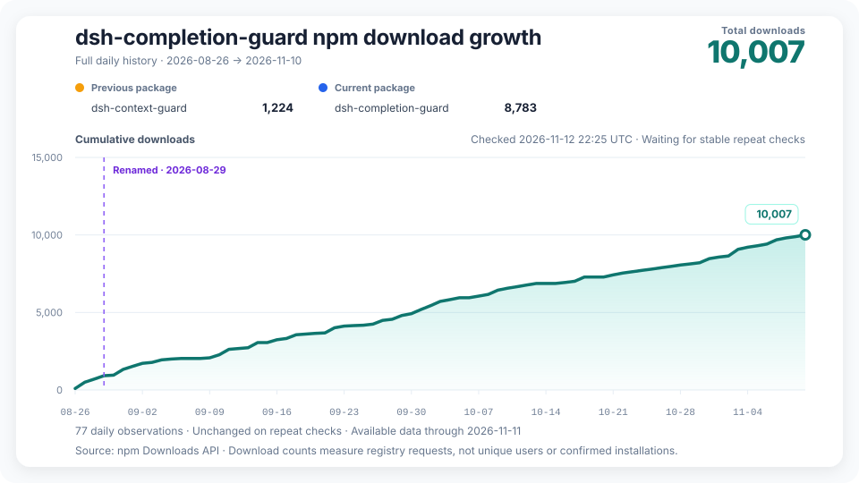

# DSH Completion Guard

[简体中文](README.zh-CN.md)

DSH Completion Guard is a DeepSeek Harness plugin for long or resumed tasks. It keeps track of what you asked for, what you ruled out, and what still needs checking.

If you ask DSH to edit a file and run its tests, Guard looks for a saved result for that file and those tests before certifying completion.

## Install or upgrade

Guard 0.13.1 requires DSH `0.2.2-rc.2`, Node.js `24.9.0`, Cordis `4.1.0` and pnpm `11` or later. Web, Headless and Desktop each have their own profile. The reviewed setup uses DSH `0.2.2-rc.2` and Cordis `4.1.0`. The `0.2.2-rc.1` host is below the minimum: upgrade DSH first, then Guard. Other versions that meet the minimum still need to pass the host checks.

- **First installation.** Stop the host and follow the [installation guide](docs/GETTING_STARTED.md) for the profile you use. Install Guard, write the **host lock** that records the packages and locations the profile loads, then verify the resulting configuration before starting DSH.
- **Upgrade with existing Guard sessions.** Stop the processes that write session data. Before replacing DSH or Guard, keep the old installation and the settings or records that establish each session's mode. Follow the [migration guide](docs/ACTIVATION_MIGRATION.md) to check the active storage directory and freeze the session inventory. After installing, rebuild and verify the host lock. Valid existing mode bindings are retained; adopt old modes only for sessions that need migration, then verify before restarting.

DSH `0.2.2-rc.2` still ships Undici `8.11.2`. The [dependency advisories](docs/DEPENDENCY_SCAN.md) explain the remaining risks. The same three temporary Undici exceptions cover Guard 0.13.1 through **2026-11-30 inclusive**; the host remains affected.

## Start a task or return to one

When reopening a session, wait for “载入历史” (loading history) to finish if it appears. DSH reads the saved history and Guard rebuilds its checklist, which can take time even on a later visit. Then run `/context-guard status`.

- A new session started from scratch normally shows `armed`. Guard waits for your first message or attachment, then starts tracking requirements in that same step. This default is called `always`.
- With explicit `activation: opt-in`, run `/context-guard on` to start tracking.
- An existing session keeps its verified initial mode and its saved on/off state. If the settings disagree with its saved mode, or the binding is missing or damaged, Guard reports the problem and withholds certification. Follow the [configuration guide](docs/GETTING_STARTED.md#choose-the-default-for-new-sessions) to change the default for new sessions.

Ask DSH to do your task as usual. When a result is missing or refers to the wrong file, command, or other target, Guard leaves that check open. Use `/context-guard status` to see what remains, `/context-guard diagnose` to understand a completion verdict, and `/context-guard off` or `on` to change protection for the current session. See the [command reference](docs/GETTING_STARTED.md#session-commands) for the other controls.

## What Guard can verify

Guard checks recorded results, and can hold open the Goal completion path it guards while required evidence is missing. If a task asks you to inspect an image, a successful tool call alone cannot establish what appeared. An investigation can end with a written answer even when Guard has no way to certify its findings.

DSH runs the tools and controls permissions. Guard starts with its `standard` policy. For stricter verification or an explicit release contract, see [completion policies](docs/GETTING_STARTED.md#completion-policies). Guard keeps size-limited, redacted records. See [privacy and stored data](docs/PRIVACY.md) for what those records contain.

## Documentation

- [Installation and first load](docs/GETTING_STARTED.md), [old-session migration and rollback](docs/ACTIVATION_MIGRATION.md)
- [Changelog](CHANGELOG.md), [host compatibility](docs/COMPATIBILITY.md), [distribution](docs/distribution.md)
- [Documentation index](docs/README.md) for architecture, tests, acceptance records and the relationship to Codex Context Guard

## npm download history

The chart separates the two npm package names and marks the August 2026 rename. Counts measure registry downloads. See the [source data](https://raw.githubusercontent.com/GreenLv/dsh-completion-guard/stats/npm-downloads.json) and [collection status](https://raw.githubusercontent.com/GreenLv/dsh-completion-guard/stats/refresh-status.json).
