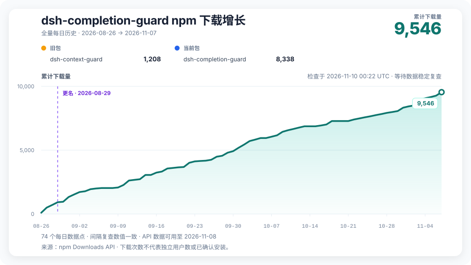

# DSH Completion Guard

[English](README.md)

DSH Completion Guard 是 DeepSeek Harness 的插件。做长任务或接着上次的会话继续时，它会记住你要求做什么、哪些操作不能做、还有哪些结果需要核对。

比如你让 DSH 修改文件并运行测试，Guard 会核对记录里是否有针对这个文件的修改结果，以及相应的测试结果，再判断任务能否通过完成检查。

## 安装或升级

Guard 0.13.1 至少需要 DSH `0.2.2-rc.2`、Node.js `24.9.0`、Cordis `4.1.0` 和 pnpm `11`。Web、Headless 和 Desktop 各用一套配置目录（profile）。已经审查的组合是 DSH `0.2.2-rc.2` 和 Cordis `4.1.0`。`0.2.2-rc.1` 宿主已低于最低要求：先升级 DSH，再升级 Guard。其他版本即使达到最低要求，也须通过安装环境检查。

- **首次安装。** 先关闭实际使用的宿主，再按[安装指南](docs/GETTING_STARTED.md)选择对应配置目录。装好 Guard 后，写入**宿主锁**，记录该配置会加载哪些包、从哪里加载。核验生成的配置后再启动 DSH。
- **已有 Guard 会话，需要升级。** 先停止会写入会话数据的进程。替换 DSH 或 Guard 前，保留旧安装，以及能确定每个会话启用模式的旧配置或记录。按[迁移指南](docs/ACTIVATION_MIGRATION.md)核对实际存储目录，保存一份固定的会话清单。装好后重建并核验宿主锁。已有有效模式绑定会原样保留；只为需要迁移的会话采纳旧模式，核验后再重启。

DSH `0.2.2-rc.2` 仍携带 Undici `8.11.2`。[依赖风险说明](docs/DEPENDENCY_SCAN.md)说明了残余风险。同三条 Undici 临时例外覆盖 Guard 0.13.1，有效至 **2026-11-30（含）**；宿主仍受影响。

## 开始任务或继续旧会话

打开旧会话时，如果看到“载入历史”，请等加载结束，再运行 `/context-guard status`。DSH 要读取旧记录，Guard 也要据此重建任务清单。再次打开时也可能需要等待。

- 从头新建的会话默认显示 `armed`，表示 Guard 已就绪。首条消息或附件进入后，它会在同一步开始记录要求。这个默认模式叫 `always`。
- 如果配置明确写了 `activation: opt-in`，请运行 `/context-guard on` 开始记录。
- 旧会话沿用已核验的初始模式和保存下来的开关状态。如果配置与记录的模式冲突，或模式记录缺失、损坏，Guard 会说明原因，并暂缓认证。要调整新会话的默认模式，见[配置指南](docs/GETTING_STARTED.md#新会话默认模式)。

照常交给 DSH 任务即可。结果缺失，或指向另一个文件、命令或对象时，对应检查会保持待完成。用 `/context-guard status` 看还差哪些结果，用 `/context-guard diagnose` 看完成检查为什么没有通过，用 `/context-guard off` 或 `on` 控制当前会话。其他操作见[命令参考](docs/GETTING_STARTED.md#session-commands)。

## Guard 能核对什么

Guard 核对已经记录的结果。它接入的 Goal 完成流程会在缺少必要证据时保持开启。例如，你要求检查一张图，仅有工具调用成功的记录还无法说明图里出现了什么。调查任务可以正常给出书面结论，即使 Guard 没有相应的认证方式。

工具和权限仍由 DSH 管理。Guard 默认采用 `standard` 策略。需要更严格的核验或明确采用发布合同，可查看[完成策略](docs/GETTING_STARTED.md#completion-policies)。Guard 保存的记录经过脱敏并有大小限制，具体范围见[隐私与数据说明](docs/PRIVACY.md)。

## 文档

- [安装与首次载入](docs/GETTING_STARTED.md)、[旧会话迁移与回退](docs/ACTIVATION_MIGRATION.md)
- [更新日志](CHANGELOG.zh-CN.md)、[宿主兼容性](docs/COMPATIBILITY.md)、[分发渠道](docs/distribution.md)
- [文档索引](docs/README.md)，包括架构、测试、验收记录以及与 Codex Context Guard 的关系

## npm 下载历史

图表分别统计两个 npm 包名，并标记 2026 年 8 月的更名。下载量按 npm 仓库的下载请求计数。详见[源数据](https://raw.githubusercontent.com/GreenLv/dsh-completion-guard/stats/npm-downloads.json)和[采集状态](https://raw.githubusercontent.com/GreenLv/dsh-completion-guard/stats/refresh-status.json)。
